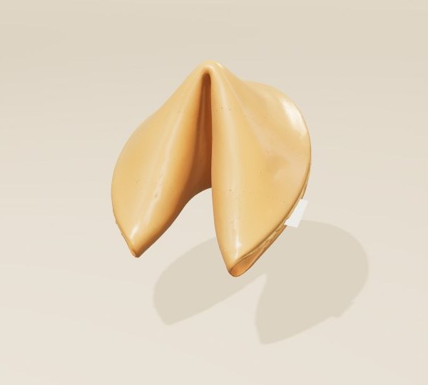
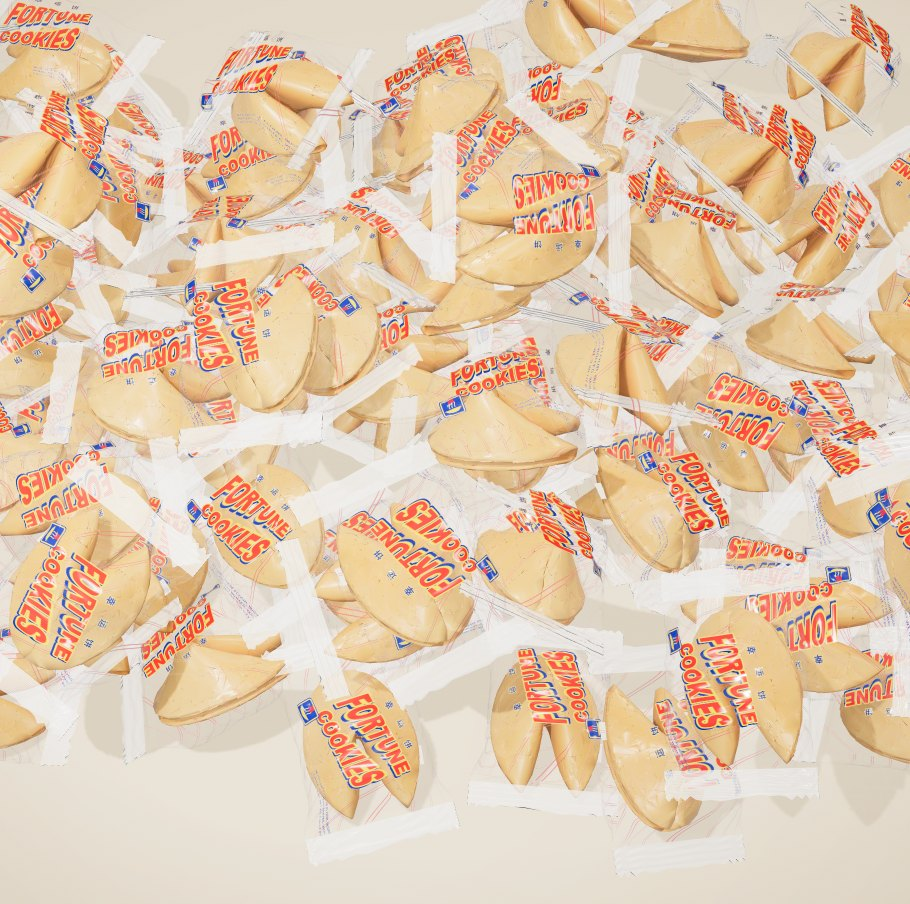
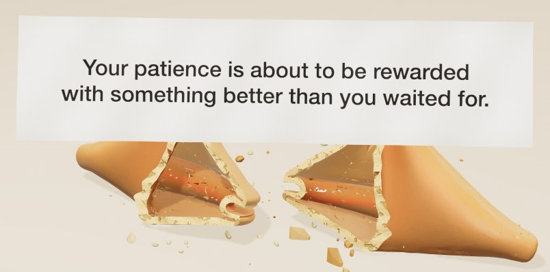

# 🥠 Fortune Cookie

**Crack open a little luck.**

👉 **[Play it here: fortune-cookie-five-pi.vercel.app](https://fortune-cookie-five-pi.vercel.app)**



A hundred wrapped fortune cookies come tumbling down the screen and land in a crinkly heap. Run your hand through the pile to hear the plastic rustle, pick the one that's calling to you, tear it open, and squeeze until it *snaps*. Out flutters your fortune: a Chinese proverb or a line of classical poetry, which you can **🔊 listen** to. Flip it over for your lucky numbers (printed in red, of course 🧧) and a Mandarin phrase to learn, then tap **🔊 how do I say this?** to hear it and see each syllable's tone.

It's a tiny, unhurried ritual, like the moment after dinner when the check comes with a little plate of cookies and everyone at the table reads theirs out loud.



## How to play

| | |
| --- | --- |
| 🫳 **Brush** | Sweep across the pile and the packs shuffle and rustle under your hand |
| ✊ **Pick** | Click a pack and it comes to you |
| 🤏 **Tear** | Tap to rip the wrapper open |
| 🫱 **Turn** | Drag to spin the cookie and admire it |
| 🤲 **Crack** | Press and hold. Feel it tremble, then *snap* |
| 👆 **Flip** | Tap the fortune to find your lucky numbers and a Mandarin phrase to learn |
| 🔊 **Listen** | "listen to your fortune" reads the front aloud: Chinese in a Mandarin voice, English in an English one |
| 🔊 **Say it** | "how do I say this?" plays the Mandarin phrase and shows every syllable's tone |
| 👉 **Again** | "another cookie" in the top-right corner. There's always another |

Keyboard works too: **Space** to pick, tear and crack, **F** to flip, **Enter** for another.



## 🏮 A little cookie with a big story

The fortune cookie is a wonderfully Asian American creation, and its story is a love letter to the communities that built it.

Its roots are usually traced to Japan, to **tsujiura senbei**: crisp, toasty crackers from the Kyoto area, folded around a tiny paper fortune and baked in hand-held irons. Japanese immigrants brought the tradition to California around the turn of the 20th century. **Makoto Hagiwara**, who looked after San Francisco's Japanese Tea Garden, is often credited with serving them to visitors, and Japanese American bakeries made them by hand.

When Japanese Americans were forcibly removed and incarcerated during World War II, **Chinese American** bakers and restaurateurs carried the cookie forward. They scaled it up and made it the sweet send-off to a meal at Chinese restaurants across the country. Today billions are folded every year, and the cookie has become a beloved, shared piece of Asian American culture: a little bit Japanese, a little bit Chinese, and wholly American.

A few of the traditions tucked into this project:

- **福 (fú, "good fortune")** appears on every wrapper's badge. At Lunar New Year it's often hung *upside down*, because "upside down" (倒, dào) sounds like "arrived" (到, dào). Fortune has arrived!
- **幸运饼 (xìngyùn bǐng)** means "lucky cookie," and you'll see it printed on the wrapper.
- **Red** is the colour of luck and celebration, which is why the lucky numbers are printed in red.
- **Learn Chinese:** on the back of every fortune you'll find a Mandarin phrase with its characters and pinyin, just like the real slips. Half are everyday phrases, and half are things your Chinese teacher won't teach you (fair warning: some are rude).

So go ahead, take one. It's good luck to read it out loud. 🥢

## Run it locally

It's one static page with no build step, but the model has to load over HTTP:

```sh
python3 -m http.server 8931
```

Then open http://localhost:8931/.

## Deployment

The site is hosted on [Vercel](https://fortune-cookie-five-pi.vercel.app) as a static site with no build step. `.vercelignore` limits the upload to `index.html` and `assets/`, so the Blender files and screenshots stay in the repo only.

## What's on the slips

There are 100 fortunes and 100 Mandarin lessons, each kept in its own shuffled deck so you won't see a repeat until you've seen them all. They live in **`assets/fortunes.js`**, so edit them there:

- **Fronts:** 50 Chinese proverbs (P01–P50) and 50 lines of classical poetry with poet and title (C01–C50).
- **Backs:** 50 *Things Your Chinese Teacher Won't Teach You* phrases (M01–M50) and 50 everyday Mandarin phrases (D01–D50), written in traditional characters.

The slip text is laid out by `assets/slip-text.js`, which shrinks it to fit. The pronunciation coach (`assets/pronounce.js`) works out each syllable's tone from the pinyin, including how tones change in speech (two 3rd tones in a row, 不 and 一). Speech uses the device's own voices through the browser's speech API: a Taiwanese Mandarin voice for Chinese where there is one (never a Cantonese one) and an American or British voice for English. How it sounds depends on the voices the device has installed. The cookie's commentary for each entry (`says`) and the lesson categories and tones are kept in `fortunes.js` but aren't shown.

## What's inside

```
index.html                 the whole app
assets/
  fortunes.js              every fortune and Mandarin lesson
  slip-text.js             lays out the text on each side of the slip
  pronounce.js             reading aloud and the "how do I say this?" pronunciation coach
  favicon.svg, favicon-32.png, apple-touch-icon.png
  cookie.glb               the cookie the page loads
blender/
  build_cookie.py          turns the Tripo model into assets/cookie.glb
  fortune_cookie.blend     the Tripo cookie and its game halves
  fortune_cookie_render.glb   the original Tripo model
  procedural/              the earlier procedural Blender cookie
docs/                      screenshots for this page
```

- **`index.html`** uses three.js r170 from a CDN, custom rigid-body physics for the cookie halves, synthesised Web Audio for every crinkle, crackle and snap, and no frameworks.
- **`assets/cookie.glb`** is decimated, hollowed and cracked into two halves, and includes light copies for the pile.
- **Rebuilding the cookie** from the Tripo model (run from the project root):
  ```sh
  blender -b --python blender/build_cookie.py -- blender/fortune_cookie_render.glb assets/cookie.glb blender/fortune_cookie.blend
  ```
